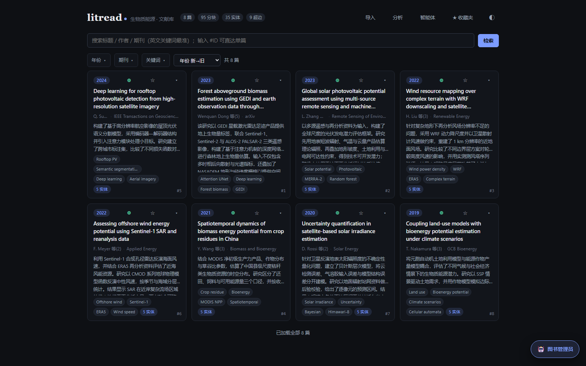
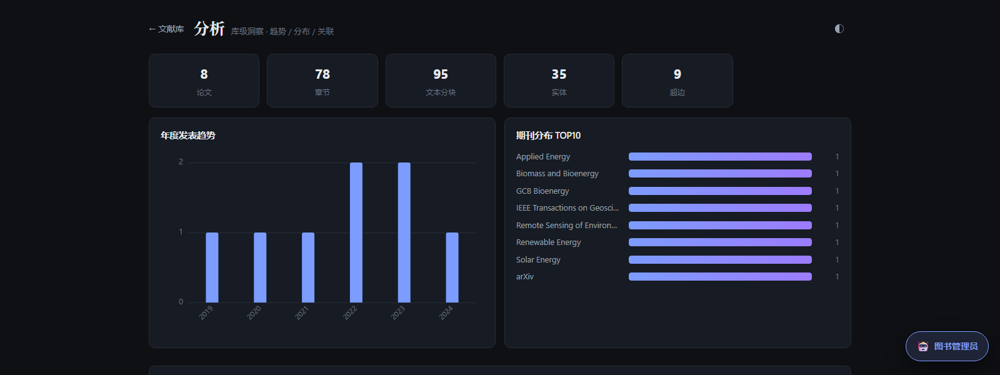

# litreview

[](https://github.com/sailieri/litreview/actions/workflows/ci.yml)
[](LICENSE)
[](https://www.python.org/)

从 PDF 到结构化知识库、再到综述终稿的全流程管线。**同一个 skill 支持两种运行方式**——用内置主智能体一键跑，或加载到你自己常用的 coding agent 里（pi / Claude Code / Codex / Cursor…），由它来担任主智能体。

📖 **完整手册见 [`skill/SKILL.md`](skill/SKILL.md)**：两种运行模式的步骤对照、脚本契约、文件契约、写作纪律。全部文档都在 `skill/`。本 README 只给概览与快速上手。

---

## 架构

```
Phase 1 · 建库                         Phase 2 · 撰写（轮次制）
① PDF 文本提取                         每一轮：
② LLM 规范化                           查库调研 → 写初稿 → 独立追问 → 硬断言
③ 超图实体+超边提取（A-C 优化）           → 写定稿 → 并行审核
④ 章节拆分入库                              ↓
⑤ 向量化                               跑完一次审核 = 本轮结束（round += 1）
                          所有产物带轮次号，跨轮复用、禁止覆盖
```

## 两种运行模式

| | **模式 A：内置主智能体** | **模式 B：自带智能体（BYO）** |
|---|---|---|
| 主智能体 | `pipelines/review/main_agent.py` 内置循环 | **你的 agent**（加载本 skill 的那个） |
| 启动 | `python pipelines/review/main_agent.py --round 1` | `python pipelines/review/main_agent.py --print-kickoff --round 1` 取开场上下文，然后按 `skill/SKILL.md` 逐步执行 |
| 写稿消耗 | `config.yaml` 配的模型 | 你自己的模型与额度 |
| 适用 | 无人值守跑批、弱模型托管 | 想用自己的 agent / 自己的模型写稿 |

两种模式**共用同一套步骤、脚本与文件契约**，产物逐字节同构，可随时互相接手。替换的只是"写综述"这个身份；检索/追问/审稿这些"简单几步"的活可交给脚本（默认实现），也可自己顺手做。



<sub>界面示意（示例数据）：卡片显示题录、叙事摘要、关键词与实体数；顶栏是库规模；右下角是图书管理员入口。</sub>



<sub>库级洞察：篇数/章节/分块/实体/跳文献超边、年度趋势、期刊分布，下方还有关键词共现网络。</sub>

**把 skill 装进你自己的 agent**（只有模式 B 需要）：`skill/` 是标准的 `SKILL.md`（带 name/description frontmatter），拷到对应目录即可：

```bash
mkdir -p ~/.claude/skills/litreview && cp -r skill/* ~/.claude/skills/litreview/   # Claude Code
mkdir -p ~/.pi/agent/skills/litreview && cp -r skill/* ~/.pi/agent/skills/litreview/  # pi
```

若你的 agent 没有 skill 机制，直接把 `skill/SKILL.md` 当 SOP 贴进上下文也成立——它本身就是一份可执行的作业手册。

## 💰 成本提醒（跑前必读）

本管线一次「建库 + 3 轮综述」是**真金白银**：以 50 篇论文、DeepSeek 空闲档计，全程 DeepSeek ≈ **¥11**（v4-pro ≈ ¥44；高峰时段 ×2）；若检索/审稿走自建推理，成本可降到 ≈ ¥1。库越大建库越贵（严格线性 ≈¥0.14/篇，300 篇全 DeepSeek 重建 ≈ ¥42），综述部分与篇数基本无关。**跑批前先估算**：

```bash
python tools/cost_calculator.py --papers 50   # 换成你的篇数；--peak / --model pro / --profile current 可切换口径
```

`pipelines/review/main_agent.py` 启动时也会自动打印预估。token 常数、价格来源与不确定度（±30%）见 `tools/cost_calculator.py` 文件头。

## 前置要求

### 模型（一共 4 个，后两个可选）

| # | 模型 | 干什么 | 必需性 | 配在哪 |
|---|---|---|---|---|
| 1 | **主对话 LLM** | 规范化、超图抽取、问答、写稿、审稿 | 必需 | `providers` + `steps`（任一 OpenAI 兼容端点：DeepSeek / vLLM / Ollama） |
| 2 | **Embedding** | 语义检索（BM25 之外那一路） | 强烈建议 | `embedding`（默认连本机 ollama `qwen3-embedding:0.6b`）。没配也能跑，向量为空、检索退化成纯关键词——**不报错，只是变差** |
| 3 | **决策模型**（判官） | 实体合并时判「两个词是不是同一实体」 | 可选 | `judge`。留空则纯靠聚类阈值，不漏不错只是略粗 |
| 4 | **翻译模型** | 网页「中英对照」把英文 PDF 译成中文 | 可选 | `providers.workstation` + `endpoints.*_idx` + `webapp.translate_*` |

> 第 4 个模型只是「由谁来译」。真正的排版保持与 PDF 重建由第三方项目
> [PDFMathTranslate](https://github.com/PDFMathTranslate/PDFMathTranslate)（**AGPL-3.0**）完成，
> 本仓库只提供薄驱动 `webapp/pdf2zh_vllm_driver.py`，以外部命令方式调用、**不包含也不改编其源码**。
> 要用它：另建一个 venv 装 `pdf2zh_next`，路径填到 `paths.pdf2zh_python`（或放 `paths.pdf2zh_dirs` 下）。
> 不装 / 不配 → 网页上的「生成对照」按钮不可用，其余功能一律不受影响。

### 环境

| 依赖 | 必需性 | 说明 |
|---|---|---|
| **Python 3.12+** | 必需 | `numpy 2.5` 要 3.12、`scikit-learn 1.9` 要 3.11，3.10/3.11 会装不上；推荐 3.13 |
| **Node 18+** | 仅网页 | `cd webapp/frontend && npm install && npm run build`；仓库不含 `dist/` |
| pdf2zh_next | 可选 | 仅中英对照需要，独立 venv（与主环境 starlette 版本冲突，不能合并） |

## 快速上手

```bash
git clone https://github.com/sailieri/litreview.git && cd litreview
uv venv .venv --python 3.13            # 或 python -m venv .venv
uv pip install -r requirements.txt     # 国内可加 -i https://pypi.tuna.tsinghua.edu.cn/simple
cp config.yaml.example config.yaml     # 填入 providers.deepseek.api_key
```

> 克隆与后续拉取需能访问 github.com；国内网络通常要挂代理（如 `git -c http.proxy=http://127.0.0.1:7890 clone …`）。
> 安装与运行不依赖网络，只有调 LLM/Embedding 时才需要出网。

**先建库，再写综述**——空库里跑 `main_agent.py` 什么也做不出来：

```bash
python tools/ingest/ingest_paper.py 我的论文.pdf --stem My2024_Keyword
python tools/doctor/doctor.py health          # 看懂库健不健康
```

批量入库见下方「Phase 1 · 建库」。

入库完只完成了三件事：**文本、章节、向量**。体检报告里还会显示「缺摘要 / 无实体」，这是正常的——
摘要与超图属于下一个环节（`pipelines/build/extract_hypergraph.py`）。想先做问答，现在的库已经够用：

```bash
python -m modules.kb_agent --q "your question in English"   # 命令行问答（带 [S#] 引用）
```

网页界面需要先构建前端（仓库不含 `dist/`）：

```bash
cd webapp/frontend && npm install && npm run build
cd ..
.venv/bin/python -m uvicorn server:app --host 127.0.0.1 --port 8790      # Windows: .venv\Scripts\python.exe
```

> 重复入库会被查重闸门拦下（按标题 / DOI / 作者 / 原文指纹四路比对）。确认是误判时加 `--force`
> 放行（会写审计 `data/dedup_forced.jsonl`）；确认是同一篇就换 `--stem` 复用已有记录。


模式 A（一行跑一轮）。**首次跑之前必须先写 PRD**——`data/reviews/meta/_prd.md`（主题 / 范围边界 / 验收标准），它是撰写阶段唯一的主题真相源；文件不存在时主智能体只会收到一句「（PRD 缺失）」。写法见 `skill/SKILL.md` 第 0 步。

```bash
python pipelines/review/main_agent.py --dry-run --round 1     # 先自查：提示词 / PRD / 工具 / 轮次状态
python pipelines/review/main_agent.py --round 1               # 跑一轮（调研 → 初稿 → 追问 → 论断 → 定稿 → 审核）
```

模式 B（自带智能体）：把本仓库交给你的 agent，让它按 `skill/SKILL.md`「运行模式 → 模式 B 步骤手册」执行；开场用

```bash
python pipelines/review/main_agent.py --print-kickoff --round 4
```

拿到与模式 A 完全一致的上下文（PRD + 上轮产物 + 已问过的问题），再由它调用 `pipelines/review/` 下的 `kb_qa.py` / `probe_draft.py` / `check_draft.py` / `review_draft.py`。

## 项目结构

```
litreview/
├── skill/                       # ★ 唯一的文档区
│   └── SKILL.md                 # ★ 双模式完整手册（权威文档，仓库唯一文档）
├── config.yaml.example          # 配置模板（providers + steps）
├── modules/                     # 核心库
│   ├── kb_agent.py              # RAG 问答引擎（网站 /api/ask 与综述管线共用）
│   ├── review/                  # 第二阶段：撰写与审稿
│   │   ├── paths.py / rounds.py # ★ 路径与轮次状态/预算的唯一真相源
│   │   ├── refs.py              # ★ 引用登记：[S#] 全局编号 / 题录 / 证据包
│   │   ├── probe.py            # 追问者实现
│   │   ├── writing/compiler.py  # 成稿整合
│   │   └── critique/review_team.py  # 并行审稿人 + F_human + H_curation
│   ├── database/                # 第一阶段：建库与检索（schema/indexer/retriever/embedder…）
│   ├── hypergraph/              # 超图提取与合并（summary/refine/merge）
│   ├── normalize/               # PDF → raw text → 规范 markdown
│   └── util/                    # llm_client（配置驱动的 LLM 客户端）+ batch（批处理入口）
├── webapp/                      # 服务层：一后端两门面（人走 HTTP，智能体走 MCP）
│   ├── server.py                # HTTP API + 托管前端
│   ├── mcp_server.py            # MCP server（供外部智能体调用）
│   ├── librarian.py             # litread 内置问答智能体（SSE）
│   ├── paper_qa.py              # 单篇问答
│   └── frontend/                # Vue3 + Vite 前端
├── pipelines/
│   ├── build/                   # Phase 1 建库：五步入口（extract_pdfs/normalize/extract_hypergraph/index/embeds）
│   └── review/                  # Phase 2 综述管线（脚本 + 主智能体）
│       ├── main_agent.py        # 模式 A 入口（--round / --dry-run / --print-kickoff）
│       ├── main_agent_prompt.md # ★ 主智能体作业纪律（模式 A 注入 / 模式 B 自读）
│       ├── kb_qa.py             # 脚本① 知识库问答（唯一信息通道，登记 [S#] 引用）
│       ├── probe_draft.py       # 脚本② 独立追问者（内部评审读者）
│       ├── check_draft.py       # 脚本③ 硬断言（章节/引用/数值溯源/流程自指/长句）
│       ├── compile_draft.py     # 脚本④ 初稿→成稿（表达层转写；备选路径）
│       └── review_draft.py      # 脚本⑤ 并行审核 + 轮次推进
├── tools/                       # 辅助工具（单篇入库、超图提取、重索引、质量检查、审计…）
└── data/                        # 运行时产物（不入仓库）：pdfs / normalized / database/papers.db / reviews
```

## Phase 1 · 建库

```bash
python pipelines/build/extract_pdfs.py         # 1. PDF → raw text
python pipelines/build/normalize.py            # 2. 规范化（LLM 清洗）
python pipelines/build/extract_hypergraph.py   # 3. 超图实体+超边提取（A-C 优化，可断点续跑）
python pipelines/build/index.py                # 4. 章节拆分 + chunks 入库
python pipelines/build/embeds.py               # 5. 向量化（chunks + 合并实体 + 跨文献超边）
python tools/graph/cluster_pipeline.py --stage 1   # 6a. 实体分簇（DBSCAN）
python tools/graph/merge_entities.py               # 6b. 实体合并（LLM）
python tools/doctor/doctor.py status           # 进度/续跑检查
```

`pipelines/build/` 只放入口（参数解析 + 调用），具体实现在 `modules/util/batch/`。

## 检索

```python
from modules.database.retriever import search

result = search("LSTM wind power forecasting")   # FTS5 BM25 + embedding 混合检索
# → {"chunks": [...], "hyperedges": [...]}
```

FTS5 使用 `unicode61` 分词器（英文词汇完整匹配），连字符术语由 `_build_fts_query()` 自动处理；**查询请用英文关键词**（中文 BM25 为 0，仅剩向量召回）。

## 配置

`config.yaml` 由 `providers` + `steps` 两段构成：`providers` 定义任意 OpenAI 兼容端点（DeepSeek / vLLM / Ollama / 其他），`steps` 指定各步骤用哪个 provider 与模型别名。脚本侧 LLM（检索问答 / 追问者 / 审稿人）走这里；模式 B 下写稿用你自己的 agent，不消耗这份配置。

## 依赖

Python **3.12+**（推荐 3.13）：`pymupdf`、`httpx`、`pyyaml`、`numpy`、`scikit-learn`、`mcp`（详见 `requirements.txt`）。

## tools/ 速查

按用途分六个子目录，脚本名即动词。

```
tools/
├── cost_calculator.py     全流程成本估算（跑批前必看）
├── ingest/                ① 入库：PDF/文本 → papers + sections + chunks + 向量
├── extract/               ② 抽取：normalized 文本 → 实体 + 超边 + 摘要
├── graph/                 ③ 建图：JSON → 库；分簇；实体合并
├── embed/                 ④ 向量：补算缺失向量
├── doctor/                ⑤ 体检：只读诊断（统一入口 doctor.py）
└── maintain/              ⑥ 维护：修数据、补元数据、治孤儿（统一入口 orphans.py）
```

```bash
python tools/ingest/ingest_paper.py paper.pdf --stem My2024_Keyword
python tools/doctor/doctor.py health                 # 全库体检
python tools/graph/merge_entities.py                 # 增量合并
python tools/maintain/orphans.py inspect             # 孤儿 PDF 盘点
```

约定：数据路径一律从 `modules/paths.py` 取；sys.path 引导用「向上找含 `modules/paths.py` 的目录」；
可被 import 的脚本把 `argparse` 放进 `if __name__ == "__main__":`。

## 安全边界（部署前看）

| 服务 | 默认端口 | 默认绑定 | 鉴权 |
|---|---|---|---|
| litread 网页 / HTTP API | 8790 | `127.0.0.1` | **无** |
| MCP（供外部智能体调用） | 8791 | `127.0.0.1` | Bearer token（`LITREAD_MCP_TOKEN`，留空 = 不鉴权） |

两个服务都**没有面向公网的加固**（无 TLS、无速率限制、无用户体系）。绑到 `0.0.0.0` 相当于向同网段完全开放：
能读写你的文献库、下载 PDF、看对话记录。只在受信任的局域网这么用；要从外网访问，前面必须加反向代理 + 鉴权。

## 文档在哪

只有两处：本 README（概览与快速上手）＋ `skill/SKILL.md`（完整手册）。
**不要在别处新增说明文档**；开发过程记录留在提交信息里，不进仓库。

例外：`pipelines/review/main_agent_prompt.md` 是 `main_agent.py` 启动时读取的 system prompt，
属于运行时输入，不是文档，必须留在原位。

## 许可证

MIT License — 见 [`LICENSE`](LICENSE)。可自由使用、修改、商用、闭源分发，保留版权声明即可。
